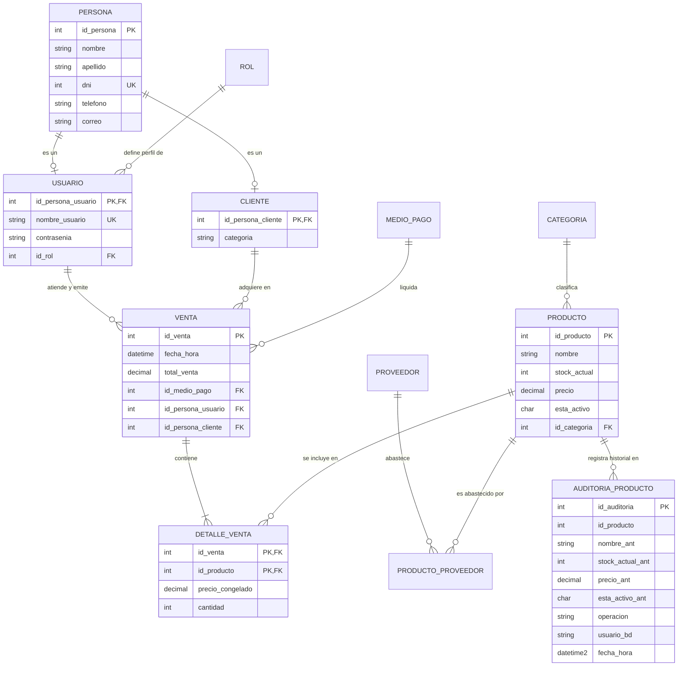

# Sistema de Gestión de Ventas e Inventario — Matiensos

[-blue)](https://www.unne.edu.ar/)
[](https://www.exa.unne.edu.ar/)
[](https://www.exa.unne.edu.ar/)
[](https://www.microsoft.com/sql-server)
[](#)
[](#)
[](#)
[](#)

---

## Información Institucional y Equipo de Trabajo

* **Institución:** Universidad Nacional del Nordeste (UNNE) — Facultad de Ciencias Exactas y Naturales y Agrimensura (FaCENA)
* **Carrera:** Licenciatura en Sistemas de Información
* **Cátedra:** Bases de Datos I — Ciclo Lectivo 2026
* **Comisión / Grupo:** Equipo 38
* **Docentes a Cargo:**
  * Lic. Villegas O. Dario
  * Mgtr. Alfonzo Pedro

### Integrantes

| Apellido y Nombre | DNI / Legajo |
|---|---|
| Romero, Ingrid Luana | 44.089.664 |
| Torres, Jemina Cesia | 42.790.791 |
| Velazco, Walter | 31.294.048 |
| Ristovich, Mauro Ezequiel Alejandro | 41.380.447 |

---

## 1. Resumen Ejecutivo y Descripción del Sistema

**Matiensos** es una solución relacional integral desarrollada para la administración comercial de una tienda física especializada en artículos materos de alta gama (mates de calabaza e imperial, bombillas de alpaca, termos de acero inoxidable, bolsos materos, yerbas artesanales y accesorios).

### Problema de Negocio y Solución Tecnológica
En el comercio minorista tradicional de mostrador, los procesos manuales y los sistemas sin control transaccional provocan quiebres imprevistos de inventario, discrepancias entre el arqueo de caja y las existencias físicas, modificaciones de precios sin respaldo de auditoría y bloqueos por ventas concurrentes.

Matiensos resuelve estas problemáticas directamente desde la capa corporativa de persistencia en **Microsoft SQL Server 2019/2022**, garantizando:
* **Control Atómico de Existencias:** Descuento de stock en tiempo real mediante transacciones ACID y bloqueos pesimistas para impedir stock negativo (*Lost Updates* y sobreventa).
* **Auditoría Transparente e Inalterable:** Registro automático de trazabilidad (*Audit Trails*) para altas, bajas y modificaciones en el catálogo de productos mediante triggers que aseguran no repudio.
* **Integridad Referencial de Negocio:** Disparadores `INSTEAD OF` que impiden el borrado accidental de categorías con artículos asociados, emitiendo advertencias operativas claras en lugar de errores técnicos crípticos.
* **Congelamiento Histórico de Precios:** Los comprobantes de venta congelan el precio unitario pactado al momento de la transacción en `DetalleVenta.precio_congelado`, asegurando la inmutabilidad contable ante futuras variaciones de precios.

---

## 2. Stack Tecnológico y Justificación Técnica

| Componente | Tecnología / Herramienta | Versión / Nivel | Justificación Técnica y Aplicación |
|---|---|---|---|
| **Motor de Base de Datos** | Microsoft SQL Server | 2019 o superior (Compatibilidad 150) | Motor relacional empresarial configurado con nivel de compatibilidad 150 para garantizar portabilidad entre todos los entornos del equipo. Asegura transaccionalidad ACID nativa, gestión pesimista de concurrencia, triggers e indexación avanzada. |
| **Lenguaje de Programación** | Transact-SQL (T-SQL) | Estándar ANSI + Extensiones MS | Implementación de DDL, DML, triggers reactivos/preventivos, funciones escalares (UDF) y procedimientos almacenados (SP). |
| **Entorno de Administración** | SQL Server Management Studio | SSMS v18+ | Entorno integral para modelado, depuración de rutinas T-SQL, análisis de planes de ejecución, métricas de I/O y configuración de seguridad. |
| **Control de Versiones** | Git & GitHub | Git CLI / Flujo Colaborativo | Control granular de versiones DDL/DML, trazabilidad de contribuciones académicas por etapas y exclusión de configuraciones locales. |

---

## 3. Arquitectura y Modelo de Datos

### 3.1 Descripción de Entidades Principales

* **`Persona`**: Superclase que unifica los datos de contacto y tributarios de todo individuo en el sistema.
* **`Usuario`**: Subtipo de `Persona` para los operadores del sistema, con autenticación, contraseña encriptada/restringida y rol asignado.
* **`Cliente`**: Subtipo de `Persona` que categoriza al comprador para el cómputo dinámico de descuentos de fidelidad.
* **`Rol`**: Perfil de seguridad que delimita las atribuciones dentro del sistema (ej. Administrador, Vendedor).
* **`Categoria`**: Clasificación jerárquica de los artículos de la tienda (ej. "Mates", "Termos", "Bombillas").
* **`Producto`**: Catálogo de artículos disponibles, existencias actuales (`stock_actual`), precio unitario y estado operativo (`esta_activo`).
* **`proveedor` & `producto_proveedor`**: Trazabilidad de abastecimiento de mercadería con registro histórico de ingresos y volúmenes por lote.
* **`Medio_Pago`**: Canales de liquidación autorizados (Efectivo, Transferencia, Tarjeta).
* **`Venta` & `DetalleVenta`**: Encabezado y líneas transaccionales de venta en mostrador; almacena `total_venta` y `precio_congelado` por ítem.
* **`auditoria_producto`**: Tabla auxiliar *Append-Only* que almacena la foto histórica previa de todo producto modificado o eliminado.

### 3.2 Diagrama Entidad-Relación (DER)



---

## 4. Reglas de Negocio, Integridad y Concurrencia

### 4.1 Restricciones Declarativas (Constraints)
* **`CK_PRODUCTO_STOCK`**: Exige que `stock_actual >= 0`, asegurando que a nivel físico jamás se admita inventario negativo.
* **`CK_PRODUCTO_PRECIO`**: Exige que todo precio de lista sea estrictamente positivo (`precio > 0`).
* **`CK_persona_dni`**: Valida que los documentos de identidad sean enteros positivos y únicos (`UQ_persona_dni`).
* **`CK_PROVEEDOR_CUIT`**: Exige formato tributario argentino válido mediante patrón de máscara `[0-9][0-9]-[0-9][0-9][0-9][0-9][0-9][0-9][0-9][0-9]-[0-9]`.

### 4.2 Lógica Procedural y Disparadores (Triggers)

#### 1. Auditoría Automática de Catálogo ([`dbo.tr_auditoria_producto`](./SQL/tecnico/triggers/tr_auditoria_producto.sql))
* **Momento y Eventos:** `AFTER UPDATE, DELETE` sobre la tabla `Producto`.
* **Mecanismo:** Utiliza la pseudotabla `deleted` para extraer la instantánea anterior del artículo antes de la mutación.
* **Campos Auditados:** `id_producto`, `nombre_ant`, `stock_actual_ant`, `precio_ant`, `esta_activo_ant`, `id_categoria_ant`, `operacion` (`'UPDATE'` o `'DELETE'`), `usuario_bd` (`SUSER_SNAME()`) y `fecha_hora` (`SYSDATETIME()`).

#### 2. Protección de Jerarquías Comerciales ([`dbo.tr_control_delete_categoria`](./SQL/tecnico/triggers/tr_control_delete_categoria.sql))
* **Momento y Eventos:** `INSTEAD OF DELETE` sobre la tabla `Categoria`.
* **Mecanismo:** Intercepta la sentencia de eliminación y consulta si existen productos asociados a las categorías a borrar.
* **Resultado:** Si detecta vinculación, aborta la operación arrojando un error personalizado de negocio (`RAISERROR`, nivel de severidad 16), evitando que el motor emita un error críptico de clave foránea. Si no tiene productos, procede al borrado seguro.

#### 3. Sincronización Automática de Totales ([`tr_DetalleVenta_Insert / Update / Delete`](./SQL/DDL/Trigger.sql))
* Recalcula y actualiza de manera reactiva el atributo derivado `Venta.total_venta` ante cualquier adición, edición de cantidades o eliminación de ítems en el detalle.

### 4.3 Manejo Transaccional y Tolerancia a Fallos (ACID)
En el procedimiento maestro [`sp_RegistrarVentaCompleta`](./SQL/tecnico/procedimientos/sp_RegistrarVentaCompleta.sql) y en los scripts de prueba:
* **Atomicidad y Rollback Seguro:** Se configura `SET NOCOUNT ON` y se gestionan transacciones explícitas con bloques `BEGIN TRY ... BEGIN TRANSACTION ... COMMIT TRANSACTION ... END TRY`. Ante excepciones, el bloque `BEGIN CATCH` ejecuta `ROLLBACK TRANSACTION` previa verificación de `@@TRANCOUNT > 0`.
* **Concurrencia Pesimista:** Se evalúa la disponibilidad de existencias con bloqueo `WITH (UPDLOCK, ROWLOCK)` antes de autorizar el débito en inventario.
* **Modularidad:** Se emplea la función escalar [`fn_CalcularDescuentoCliente`](./SQL/tecnico/funciones/fn_CalcularDescuentoCliente.sql) para computar bonificaciones comerciales según la categoría del cliente.

### 4.4 Seguridad Basada en Roles (RBAC) y Principio de Menor Privilegio
Configurado en [`Seguridad.sql`](./SQL/tecnico/seguridad/Seguridad.sql) y validado en [`prueba_seguridad.sql`](./SQL/tecnico/seguridad/prueba_seguridad.sql):
* **`usuario_admin`:** Miembro del rol fijo `db_owner` con control integral sobre el esquema y mantenimiento.
* **`rol_vendedor` / `usuario_vendedor`:** Permiso exclusivo para ejecutar el SP de ventas (`EXECUTE ON dbo.sp_RegistrarVentaCompleta`) y lectura de tablas de apoyo (`Producto`, `Categoria`, `Cliente`, `Medio_Pago`), sin permisos de modificación directa sobre tablas base.
* **`usuario_lector`:** Acceso de lectura analítica general sobre el esquema `dbo`, con denegación explícita sobre credenciales (`DENY SELECT ON dbo.Usuario (contraseña)`).

---

## 5. Estructura del Repositorio y Documentación

### Estructura de Archivos

```text
proyecto-bd1-equipo_38/
│
├── README.md
├── antigravity_rules.md
├── .gitignore
│
├── docs/
│   ├── etapa-01/
│   │   ├── 01-Descripcion-Caso.md
│   │   ├── 02-alcance.md
│   │   ├── 03-reglas-negocio.md
│   │   └── 04-decisiones.md
│   ├── etapa-02/
│   │   ├── 02-Normalizacion.md
│   │   ├── 03-decisiones-diseño.md
│   │   ├── 04-modelo-relacional.md
│   │   └── der/
│   │       ├── modelo_concepto.png
│   │       ├── modelo_conceptual.md
│   │       └── modelo_relacional.png
│   ├── etapa-03/
│   │   └── implementacion.md
│   ├── etapa-04/
│   │   ├── Caso de uso/
│   │   │   └── Consulta-Caso-Uso-03.drawio
│   │   ├── casos-uso.md
│   │   ├── comprobante-venta.md
│   │   ├── consulta-avanzada.md
│   │   └── informe-ventas.md
│   └── etapa-05/
│       ├── indices-optimizacion.md
│       ├── procedimientos-funciones.md
│       ├── seguridad.md
│       ├── transacciones.md
│       └── triggers-auditoria.md
│
└── SQL/
    ├── DDL/
    │   ├── Clientes_Ventas.sql
    │   ├── crear_bd.sql
    │   ├── Mejoras.sql
    │   └── Trigger.sql
    ├── DML/
    │   ├── datos_prueba.sql
    │   ├── poblacion_personas.sql
    │   ├── poblacion_ventas.sql
    │   ├── registrar_venta.sql
    │   └── test_trigger_total.sql
    ├── consultas/
    │   ├── comprobante-venta.sql
    │   ├── consulta-avanzada.sql.sql
    │   └── informe-ventas.sql
    └── tecnico/
        ├── funciones/
        │   └── fn_CalcularDescuentoCliente.sql
        ├── Optimizacion/
        │   └── optimizacion.sql
        ├── procedimientos/
        │   └── sp_RegistrarVentaCompleta.sql
        ├── seguridad/
        │   ├── prueba_seguridad.sql
        │   └── Seguridad.sql
        ├── transacciones/
        │   └── demo_transacciones_stock.sql
        └── triggers/
            ├── tr_auditoria_producto.sql
            └── tr_control_delete_categoria.sql
```

### Documentación Académica (docs/)

* **Etapa 01 — Análisis:**
  * [01-Descripcion-Caso.md](./docs/etapa-01/01-Descripcion-Caso.md)
  * [02-alcance.md](./docs/etapa-01/02-alcance.md)
  * [03-reglas-negocio.md](./docs/etapa-01/03-reglas-negocio.md)
  * [04-decisiones.md](./docs/etapa-01/04-decisiones.md)
* **Etapa 02 — Diseño:**
  * [02-Normalizacion.md](./docs/etapa-02/02-Normalizacion.md)
  * [03-decisiones-diseño.md](./docs/etapa-02/03-decisiones-diseño.md)
  * [04-modelo-relacional.md](./docs/etapa-02/04-modelo-relacional.md)
  * [modelo_conceptual.md](./docs/etapa-02/der/modelo_conceptual.md)
  * [modelo_concepto.png](./docs/etapa-02/der/modelo_concepto.png)
  * [modelo_relacional.png](./docs/etapa-02/der/modelo_relacional.png)
* **Etapa 03 — Implementación:**
  * [implementacion.md](./docs/etapa-03/implementacion.md)
* **Etapa 04 — Casos de Uso y Consultas:**
  * [casos-uso.md](./docs/etapa-04/casos-uso.md)
  * [comprobante-venta.md](./docs/etapa-04/comprobante-venta.md)
  * [consulta-avanzada.md](./docs/etapa-04/consulta-avanzada.md)
  * [informe-ventas.md](./docs/etapa-04/informe-ventas.md)
  * [Consulta-Caso-Uso-03.drawio](./docs/etapa-04/Caso%20de%20uso/Consulta-Caso-Uso-03.drawio)
* **Etapa 05 — Temas Técnicos Avanzados:**
  * [indices-optimizacion.md](./docs/etapa-05/indices-optimizacion.md)
  * [procedimientos-funciones.md](./docs/etapa-05/procedimientos-funciones.md)
  * [seguridad.md](./docs/etapa-05/seguridad.md)
  * [transacciones.md](./docs/etapa-05/transacciones.md)
  * [triggers-auditoria.md](./docs/etapa-05/triggers-auditoria.md)

### Scripts de Base de Datos (SQL/)

* **DDL (Definición de Esquema y Triggers de Venta):**
  * [crear_bd.sql](./SQL/DDL/crear_bd.sql)
  * [Mejoras.sql](./SQL/DDL/Mejoras.sql)
  * [Trigger.sql](./SQL/DDL/Trigger.sql)
  * [Clientes_Ventas.sql](./SQL/DDL/Clientes_Ventas.sql)
* **DML (Población Semilla y Pruebas):**
  * [datos_prueba.sql](./SQL/DML/datos_prueba.sql)
  * [poblacion_personas.sql](./SQL/DML/poblacion_personas.sql)
  * [poblacion_ventas.sql](./SQL/DML/poblacion_ventas.sql)
  * [registrar_venta.sql](./SQL/DML/registrar_venta.sql)
  * [test_trigger_total.sql](./SQL/DML/test_trigger_total.sql)
* **Consultas de Negocio y Reportes:**
  * [comprobante-venta.sql](./SQL/consultas/comprobante-venta.sql)
  * [consulta-avanzada.sql.sql](./SQL/consultas/consulta-avanzada.sql.sql)
  * [informe-ventas.sql](./SQL/consultas/informe-ventas.sql)
* **Implementaciones Técnicas Avanzadas:**
  * [fn_CalcularDescuentoCliente.sql](./SQL/tecnico/funciones/fn_CalcularDescuentoCliente.sql)
  * [sp_RegistrarVentaCompleta.sql](./SQL/tecnico/procedimientos/sp_RegistrarVentaCompleta.sql)
  * [tr_auditoria_producto.sql](./SQL/tecnico/triggers/tr_auditoria_producto.sql)
  * [tr_control_delete_categoria.sql](./SQL/tecnico/triggers/tr_control_delete_categoria.sql)
  * [demo_transacciones_stock.sql](./SQL/tecnico/transacciones/demo_transacciones_stock.sql)
  * [Seguridad.sql](./SQL/tecnico/seguridad/Seguridad.sql)
  * [prueba_seguridad.sql](./SQL/tecnico/seguridad/prueba_seguridad.sql)
  * [optimizacion.sql](./SQL/tecnico/Optimizacion/optimizacion.sql)

---

## 6. Guía de Instalación y Despliegue Local en SSMS

Para desplegar la base de datos en una instancia local de **Microsoft SQL Server**, abrir **SQL Server Management Studio (SSMS)** y ejecutar los scripts en el orden estricto de dependencias indicado a continuación:

### Prerrequisitos de Software
1. **Motor de Base de Datos:** Microsoft SQL Server 2019 o superior (compatible con SQL Server 2022 - ediciones Developer, Express o Standard).
2. **Herramienta de Administración:** SQL Server Management Studio (SSMS) versión 18.x o superior.
3. **Control de Versiones:** Git (para clonación del repositorio).
4. **Permisos de Instancia:** Permisos de administrador (`sysadmin` / `dbcreator`) en la instancia local.

> [!NOTE]
> **Nota de Compatibilidad:** Los scripts DDL, DML y triggers respetan el nivel de compatibilidad de SQL Server 2019 (`150`) para asegurar portabilidad inmediata en cualquier entorno del equipo.

### Secuencia Ordenada de Ejecución

1. [SQL/DDL/crear_bd.sql](./SQL/DDL/crear_bd.sql)  
   *(Crea la base de datos `sistema_matiensos`, tipos de datos, tablas primarias y restricciones iniciales).*
2. [SQL/DDL/Mejoras.sql](./SQL/DDL/Mejoras.sql)  
   *(Aplica claves foráneas y restricciones avanzadas).*
3. [SQL/DDL/Trigger.sql](./SQL/DDL/Trigger.sql)  
   *(Instala triggers de auto-incremento y recálculo de totales en ventas).*
4. [SQL/tecnico/triggers/tr_auditoria_producto.sql](./SQL/tecnico/triggers/tr_auditoria_producto.sql) y [SQL/tecnico/triggers/tr_control_delete_categoria.sql](./SQL/tecnico/triggers/tr_control_delete_categoria.sql)  
   *(Crea la tabla y trigger de auditoría de productos y la protección de borrado de categorías).*
5. [SQL/tecnico/funciones/fn_CalcularDescuentoCliente.sql](./SQL/tecnico/funciones/fn_CalcularDescuentoCliente.sql) y [SQL/tecnico/procedimientos/sp_RegistrarVentaCompleta.sql](./SQL/tecnico/procedimientos/sp_RegistrarVentaCompleta.sql)  
   *(Instala la función escalar de fidelidad y el procedimiento transaccional de ventas).*
6. [SQL/DML/datos_prueba.sql](./SQL/DML/datos_prueba.sql), [SQL/DML/poblacion_personas.sql](./SQL/DML/poblacion_personas.sql) y [SQL/DML/poblacion_ventas.sql](./SQL/DML/poblacion_ventas.sql)  
   *(Población semilla de catálogo, personas, clientes, usuarios y ventas históricas).*
7. [SQL/tecnico/seguridad/Seguridad.sql](./SQL/tecnico/seguridad/Seguridad.sql)  
   *(Crea logins de servidor, usuarios de base de datos y asigna roles/permisos RBAC).*

---

## 7. Pruebas y Verificación

A continuación se presentan los casos de prueba reproducibles para verificar la integridad del sistema desde SSMS:

### Prueba 1: Auditoría Automática de Producto (`tr_auditoria_producto`)

```sql
USE sistema_matiensos;
GO

-- 1. Consultar estado previo de un producto
SELECT id_producto, nombre, stock_actual, precio FROM Producto WHERE id_producto = 1;

-- 2. Modificar precio y stock del producto (simulando actualización de catálogo)
UPDATE Producto
SET precio = precio * 1.15,
    stock_actual = stock_actual - 3
WHERE id_producto = 1;

-- 3. Verificar que el trigger insertó automáticamente el registro histórico
SELECT TOP 1 id_auditoria, id_producto, nombre_ant, stock_actual_ant, precio_ant, operacion, usuario_bd, fecha_hora
FROM dbo.auditoria_producto
WHERE id_producto = 1
ORDER BY fecha_hora DESC;
-- Resultado esperado: Se visualiza operacion = 'UPDATE', el usuario SQL conectado y los valores anteriores exactos.
```

### Prueba 2: Control de Integridad Preventivo en Categorías (`tr_control_delete_categoria`)

```sql
USE sistema_matiensos;
GO

-- Intento de eliminación de la categoría 'Mates' (id_categoria = 1), la cual posee productos asociados
DELETE FROM Categoria WHERE id_categoria = 1;

-- Resultado esperado: 
-- Mensaje de negocio personalizado: 
-- "Msg 50000: Operación cancelada: No es posible eliminar una categoría que tenga productos asociados."
-- La categoría permanece intacta en la base de datos.
```

### Prueba 3: Concurrencia y Atomicidad en Transacciones de Stock

```sql
USE sistema_matiensos;
GO

-- Intento de venta que supera las existencias físicas disponibles
DECLARE @IdVenta INT;

BEGIN TRY
    EXEC dbo.sp_RegistrarVentaCompleta
        @id_persona_usuario = 2,
        @id_persona_cliente = 4,
        @id_medio_pago = 1,
        @id_producto = 1,
        @cantidad = 99999, -- Demanda muy superior al stock disponible
        @id_venta_generada = @IdVenta OUTPUT;
END TRY
BEGIN CATCH
    PRINT 'Validación exitosa: ' + ERROR_MESSAGE();
    -- Resultado esperado: Arroja "Stock insuficiente para concretar la venta."
    -- No se genera comprobante en Venta ni se descuentan unidades en Producto (Atomicidad garantizada).
END CATCH;
```
